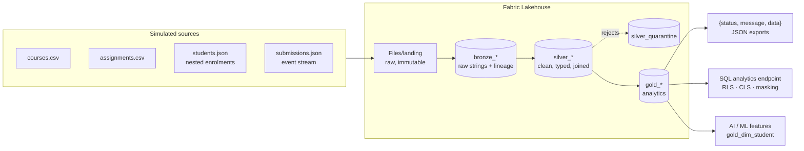

# Class Assignments & Submissions — Fabric Medallion Pipeline

A Bronze → Silver → Gold data pipeline on **Microsoft Fabric** (Lakehouse + PySpark notebook + SQL analytics endpoint) that ingests students, courses, assignments and submissions, models them into analytical tables, and serves product questions as an API-ready `{status, message, data}` contract.

The same code runs **in Fabric** and **on a laptop / CI** (plain PySpark), so everything is testable.

---

## 1. Architecture



| Layer | Tables | What happens |
|---|---|---|
| **Bronze** | `bronze_courses`, `bronze_assignments`, `bronze_students`, `bronze_submissions` | Files loaded as-is, **every column string**, plus `_source_file`, `_ingested_at`, `_batch_id`. Replayable. |
| **Silver** | `silver_courses`, `silver_students`, `silver_enrollments`, `silver_assignments`, `silver_submissions`, `silver_student_assignment_status`, `silver_quarantine` | Trim/normalise keys, multi-format date parsing, CDC dedup, resubmission collapsing, FK enforcement, quarantine with reason, and the **student ↔ assignment ↔ submission mapping**. |
| **Gold** | `gold_course_submission_rate`, `gold_student_overdue_metrics`, `gold_assignment_summary`, `gold_dim_student` (masked) | Business metrics built in Spark SQL from `sql/gold/*.sql`. |

### Simulated source data
`src/pipeline/generate_data.py` produces deterministic data (seed 42): 5 courses, 15 assignments (2 already due + 1 future per course), 60 students, ~310 submission events. It is **deliberately dirty** so Silver has real work:

| Injected problem | Handled in Silver by |
|---|---|
| Padded / lower-case IDs (`" s0012 "`, `"c002"`) | `upper(trim())` on keys |
| Mixed timestamp formats, one `"not-a-date"` | `coalesce(try_to_timestamp(...))` → quarantine `INVALID_TIMESTAMP` |
| Duplicate student record (CDC update) | window, latest `updated_at` wins |
| Duplicate course row / replayed submission event | `dropDuplicates` on key |
| Resubmissions | latest score kept, lateness judged on first attempt, `attempt_count` |
| Orphan student / assignment / course | quarantine `UNKNOWN_*` |
| Student submitting to a course they're not in | quarantine `NOT_ENROLLED` |
| Negative score | nulled, `score_valid = false` |

### Business rules (so the numbers are explainable)
* **As-of date** is fixed (`AS_OF_DATE`, default `2026-10-15`) so results are reproducible.
* An assignment is **due** when `due_at < as_of_date`.
* **Status** per student×assignment: `SUBMITTED_ON_TIME`, `SUBMITTED_LATE`, `MISSING_OVERDUE`, `PENDING`.
* **Submission rate %** = submissions for due assignments ÷ (enrolled students × due assignments). Future assignments don't drag the rate down.
* **Overdue assignment count** = past-due assignments with no submission. Late submissions are reported separately (`late_submission_count`).
* "Has not submitted Assignment_101" only considers students **enrolled** in its course.

---

## 2. Repository layout

```
├── notebooks/fabric_medallion_pipeline.ipynb   # Fabric notebook (generated, with outputs)
├── src/pipeline/
│   ├── config.py          # Fabric vs local detection, paths, settings
│   ├── spark_utils.py     # session, saveAsTable helper, display()
│   ├── generate_data.py   # simulated source systems
│   ├── bronze.py          # raw ingestion + lineage
│   ├── silver.py          # cleaning, conformance, quarantine, status mapping
│   ├── sql_loader.py      # loads sql/*.sql
│   ├── gold.py            # Gold tables from SQL
│   ├── api.py             # {status, message, data} + exports
│   ├── quality.py         # data-quality gates
│   ├── governance.py      # masking, RLS, CLS, catalog tagging
│   └── orchestrator.py    # generate → bronze → silver → gold → quality → governance → export
├── sql/
│   ├── gold/              # Gold table definitions (Spark SQL)
│   ├── queries/           # Part 2 questions (Spark SQL)
│   └── security/          # T-SQL RLS / CLS / dynamic data masking for the SQL endpoint
├── scripts/
│   ├── run_pipeline.py    # CLI orchestration
│   └── build_notebook.py  # regenerates the notebook from src/ + sql/
├── tests/                 # unit + end-to-end tests (16)
├── .github/workflows/ci.yml   # GitHub Actions
├── azure-pipelines.yml        # Azure DevOps equivalent
├── data/raw/                  # the simulated source files (for inspection)
├── docs/sample_outputs/       # API JSON, Gold CSVs, data catalog, run summary from a real run
└── .env.example
```

`src/` is the single source of truth. The notebook is **generated** from it (`python scripts/build_notebook.py`), so the Fabric notebook and the CI-tested code can't drift apart.

---

## 3. How to run

### Option A — Microsoft Fabric (primary)
1. In a Fabric workspace (Trial capacity is fine): **New item → Lakehouse**, name it `lh_education`.
2. **New item → Import notebook** → upload `notebooks/fabric_medallion_pipeline.ipynb`.
3. Open the notebook → left panel **Lakehouses → Add → Existing lakehouse → `lh_education`** (it must be the *default* lakehouse). Language: **PySpark (Python)**.
4. Click **Run all**. The notebook generates the sources into `Files/landing`, writes Delta tables into `Tables/`, runs the queries, the DQ gates, the security demo and the exports.
5. Explore:
   * **Tables** in the lakehouse explorer (`bronze_*`, `silver_*`, `gold_*`).
   * `Files/exports/api/*.json` — API payloads; `Files/exports/gold/*.csv`; `Files/exports/catalog/data_catalog.json`.
   * **SQL analytics endpoint** (switch in the top-right of the lakehouse) → run the files in `sql/queries/` (they're plain SQL over the same tables), and `sql/security/fabric_sql_endpoint_security.sql` for real RLS/CLS/masking.
6. *(Optional)* Schedule: notebook **Run → Schedule**, or add it to a **Data pipeline** with a Notebook activity.

### Option B — Local (laptop or CI)
Requirements: Python 3.10–3.11 and Java 17 (Spark needs a JVM; `java -version` to check).

```bash
git clone <repo-url> && cd <repo>
python -m venv .venv && source .venv/bin/activate      # Windows: .venv\Scripts\activate
pip install -r requirements-dev.txt
cp .env.example .env                                    # optional overrides

python scripts/run_pipeline.py                          # full run
python scripts/run_pipeline.py --steps bronze,silver,gold --as-of 2026-11-01   # partial / other date
pytest                                                  # 16 tests (~4 min, Spark start-up dominates)

# notebook locally
python scripts/build_notebook.py
PIPELINE_ENV=local jupyter nbconvert --to notebook --execute --inplace notebooks/fabric_medallion_pipeline.ipynb
```
Outputs land in `./lakehouse/Files/exports/` (tables in `./lakehouse/Tables/` as Parquet; Delta in Fabric).

### Option C — CI/CD
Push to GitHub: `.github/workflows/ci.yml` installs Python + Java, lints (ruff), runs the tests, runs the full pipeline and uploads the outputs as a build artifact. `azure-pipelines.yml` does the same in Azure DevOps and publishes JUnit results. A gated `deploy` stage is included as a placeholder for promotion via Fabric Git integration / deployment pipelines (enable with `FABRIC_DEPLOY=true`; credentials come from CI secrets, never from the repo).

---

## 4. Part 2 results (as of 2026-10-15, seed 42)

**Q1 – Not submitted Assignment_101:** 12 students (all enrolled in C001).

**Q2 – Submission rate per course**

| course | enrolled | due assignments | expected | submitted | rate % | on-time % |
|---|---|---|---|---|---|---|
| C004 Cloud Architecture on Azure | 31 | 2 | 62 | 53 | 85.48 | 77.42 |
| C003 Statistics for Analytics | 29 | 2 | 58 | 49 | 84.48 | 74.14 |
| C002 Machine Learning I | 25 | 2 | 50 | 41 | 82.00 | 66.00 |
| C001 Data Engineering Fundamentals | 38 | 2 | 76 | 56 | 73.68 | 59.21 |
| C005 Business Intelligence & Visualisation | 29 | 1 | 29 | 19 | 65.52 | 51.72 |

**Q3 – Overdue count per student:** one row per student (60), with `overdue_assignment_count`, `late_submission_count`, `max_days_overdue` and a `risk_band`.

**API envelope** (`docs/sample_outputs/api/*.json`):
```json
{
  "status": "success",
  "message": "12 student(s) have not submitted Assignment_101",
  "data": [
    {"student_id": "S0001", "first_name": "Liam", "last_name": "Chen", "course_id": "C001",
     "assignment_id": "Assignment_101", "due_at": "2026-09-20T23:59:00", "days_past_due": 25}
  ]
}
```
Errors use the same shape: `{"status": "error", "message": "...", "data": []}`.

---

## 5. Automation & testing (Part 3)
* `run_pipeline()` chains all steps, logs row counts, times each step, **fails fast**, and writes `Files/exports/run_summary.json`.
* **Data-quality gates** (`quality.py`) block a bad batch: primary-key uniqueness, not-null keys, referential integrity, rate within 0–100, score within range, and cross-layer reconciliation (Silver submissions = submitted rows in the status mapping; every student appears in Gold).
* **Tests**: unit tests on tiny DataFrames (date parsing, CDC dedup, resubmission rules, status classification) and end-to-end tests — including a **pure-Python recomputation of Q1** from the raw files that must match the Spark/SQL answer, the API contract, quarantine reasons, RLS and masking.

## 6. Security & governance (Part 4, bonus)
| Control | Spark mock (`governance.py`) | Fabric native (`sql/security/…sql`) |
|---|---|---|
| Row-level security | `secure_read()` – instructor sees only own courses | `CREATE SECURITY POLICY` with predicate function |
| Column-level security | ML service account gets no identity columns | `GRANT/DENY SELECT (columns)` |
| Data masking | email `l***@university.edu`, phone `***-***-1488`, DOB `2001-**-**`, surname `C.` | `ADD MASKED WITH (FUNCTION = …)`, `GRANT UNMASK` |
| Catalog / tagging | `TBLPROPERTIES` (layer, sensitivity, pii_columns, data_owner, domain) + `data_catalog.json` | Purview sensitivity labels, endorsement |
| Pseudonymisation | `gold_dim_student.student_key = sha2(student_id + salt)` for ML joins | — |

In production the user → role mapping would come from Entra ID groups and the salt from Key Vault.

## 7. Assumptions & next steps
* Batch, full-refresh loads for clarity. Next: incremental Bronze append + `MERGE INTO` Silver keyed on `submission_id`, watermark on `_ingested_at`.
* Local runs use Parquet to avoid extra jars; Fabric uses Delta automatically (`TABLE_FORMAT`).
* Next: Fabric Data Pipeline trigger on file arrival, Power BI semantic model on Gold, and a thin FastAPI wrapper around `run_query()`.
